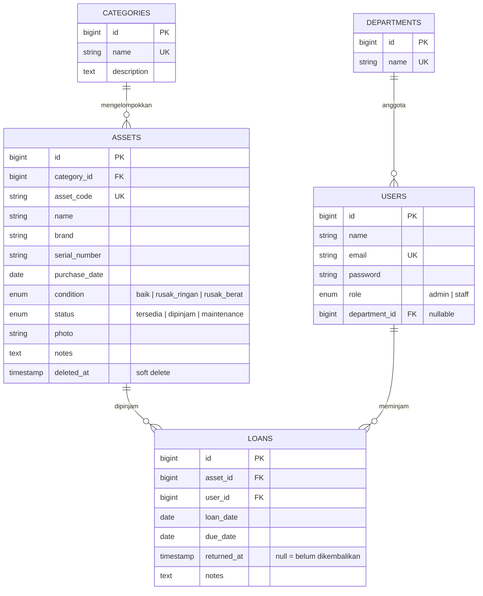
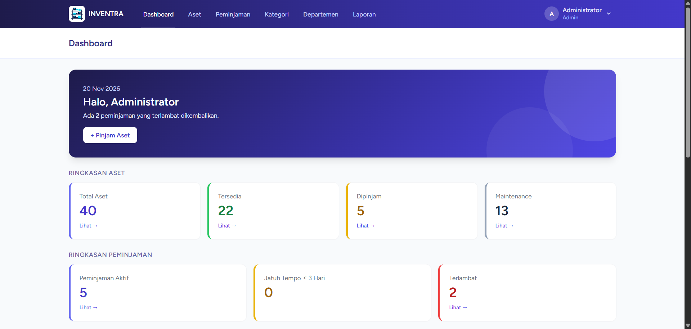
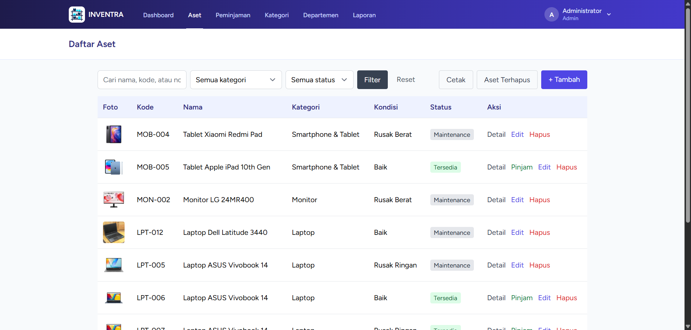
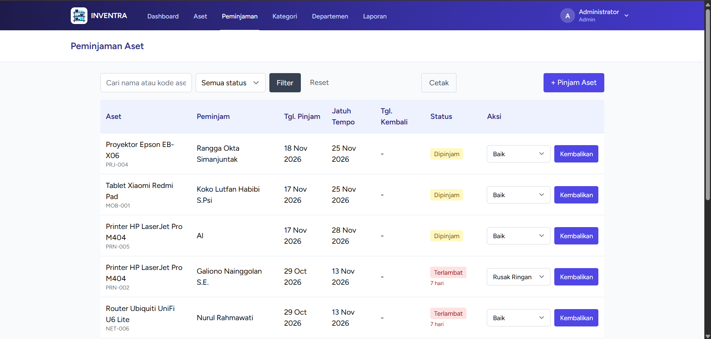

# Sistem Manajemen Aset dan Peminjaman Perangkat IT

Aplikasi web berbasis Laravel untuk mencatat aset perangkat IT perusahaan dan
mengelola peminjamannya oleh karyawan. Dibuat sebagai tugas magang di PT INTI,
divisi Bisnis dan Teknologi (bidang Teknologi Informasi). Dijalankan di localhost.

## Fitur

- Autentikasi (login, logout, register) dengan dua peran: **admin** dan **staff**
- CRUD **Kategori** dan **Departemen** (khusus admin)
- CRUD **Aset**: kode aset unik, foto, kondisi, status, pencarian, filter, pagination, soft delete
- Modul **Peminjaman**: pengajuan pinjam, batas jatuh tempo, pencatatan pengembalian
- **Dashboard** statistik aset dan peminjaman, berbeda untuk admin dan staff

## Teknologi

| Komponen | Versi / Keterangan |
|---|---|
| Framework | Laravel Framework 13.40.0 |
| PHP | PHP 8.5.7 |
| Database | MySQL |
| Autentikasi | Laravel Breeze (Blade) |
| Tampilan | Blade, Tailwind CSS, Vite |
| Lingkungan | Laragon (Windows) |

## Hak Akses

| Fitur | Admin | Staff |
|---|---|---|
| Dashboard | Statistik seluruh data | Statistik peminjaman milik sendiri |
| Kategori dan Departemen | CRUD | Tidak ada akses |
| Aset | CRUD | Hanya melihat daftar dan detail |
| Peminjaman | Melihat semua, meminjam untuk siapa saja, mencatat pengembalian | Meminjam untuk diri sendiri, melihat milik sendiri |

## Aturan Bisnis

- Hanya aset berstatus **Tersedia** yang bisa dipinjam.
- Satu aset tidak bisa dipinjam dua orang bersamaan (proses dikunci di dalam transaksi database).
- Maksimal **3 peminjaman aktif** per orang dan jatuh tempo maksimal **30 hari**.
- Aset yang sedang dipinjam tidak bisa dihapus, dan statusnya tidak bisa diubah manual.
- Saat dikembalikan, admin mencatat kondisi aset. Aset **rusak berat** otomatis masuk **Maintenance**.
- Kategori dan departemen yang masih dipakai tidak bisa dihapus.
- Aset dihapus dengan soft delete supaya riwayat peminjaman tetap utuh.
- Status peminjaman (Dipinjam, Terlambat, Dikembalikan) dihitung otomatis dari tanggal.

## Instalasi

Prasyarat: PHP [versi], Composer, Node.js (LTS), MySQL, Git.

```bash
git clone [url-repository] asset-management
cd asset-management

composer install
npm install

cp .env.example .env
php artisan key:generate
```

Buat database kosong bernama `asset_management`, lalu sesuaikan `DB_USERNAME` dan
`DB_PASSWORD` di file `.env`. Setelah itu:

```bash
php artisan migrate --seed
php artisan storage:link
```

Jalankan di dua terminal:

```bash
php artisan serve
npm run dev
```

Buka http://127.0.0.1:8000.

## Akun Demo (hasil seeder)

| Peran | Email | Password |
|---|---|---|
| Admin | admin@example.com | password |
| Staff | staff@example.com | password |

Akun ini hanya untuk lingkungan lokal dan harus diganti jika aplikasi dipakai di luar localhost.

Seeder juga membuat 6 departemen, 6 kategori, 40 aset, dan 11 data peminjaman
(sudah dikembalikan, aktif, dan terlambat).

## Struktur Database



## Pengujian

Buat database `asset_management_test`, pastikan `phpunit.xml` mengarah ke sana, lalu:

```bash
php artisan test
```

## Tangkapan Layar

| Halaman | Gambar |
|---|---|
| Dashboard admin |  |
| Daftar aset |  |
| Form peminjaman |  |
| Daftar peminjaman |  |

## Rencana Pengembangan

- Manajemen user oleh admin (menutup registrasi publik)
- Ekspor laporan ke Excel atau PDF
- Notifikasi email untuk peminjaman yang terlambat
- Halaman riwayat aset dan pemulihan aset yang dihapus
