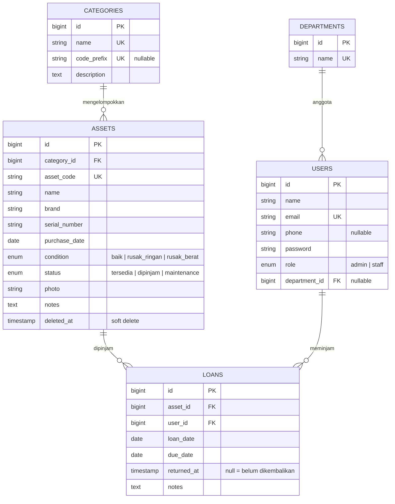
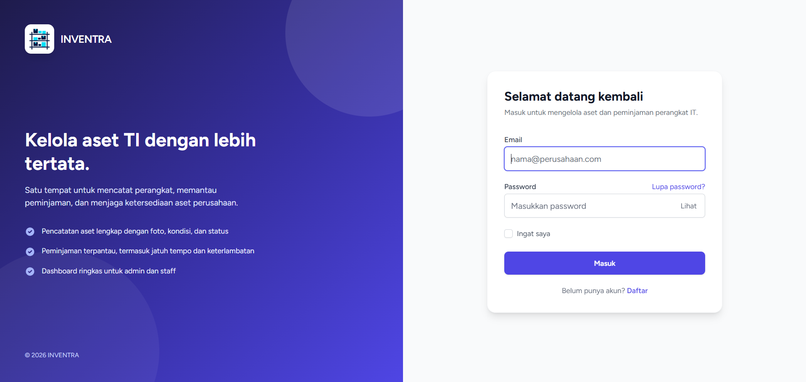
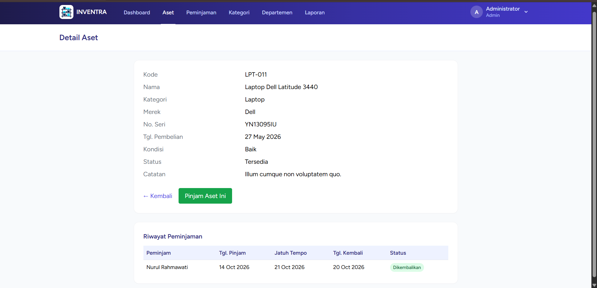
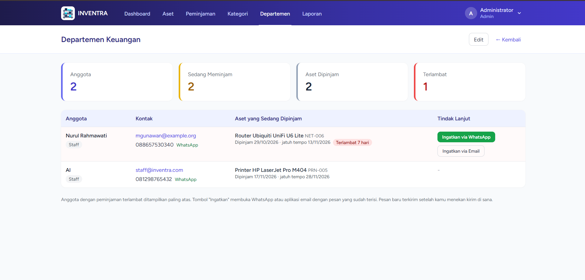
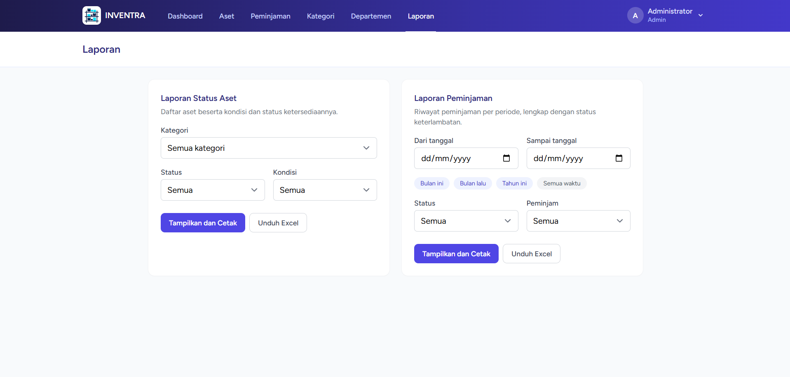
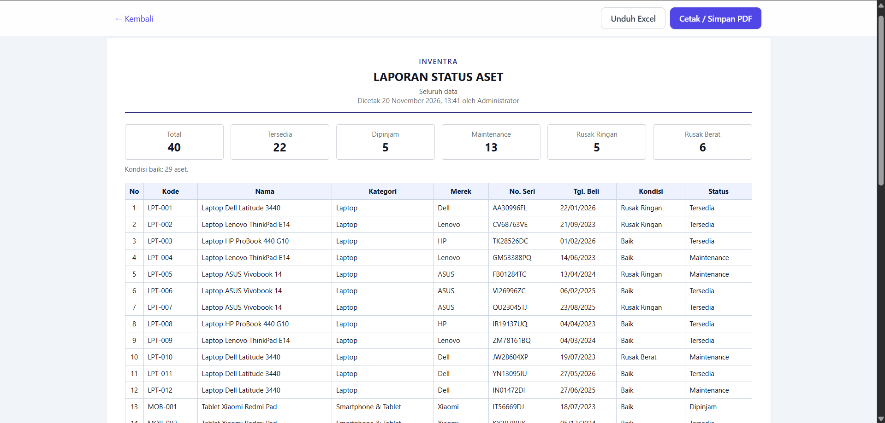

# Sistem Manajemen Aset dan Peminjaman Perangkat IT

Aplikasi web berbasis Laravel untuk mencatat aset perangkat IT perusahaan dan mengelola
peminjamannya oleh karyawan, lengkap dengan pemantauan keterlambatan dan laporan yang bisa
dicetak. Dibuat sebagai tugas magang di PT INTI, divisi Bisnis dan Teknologi (bidang Teknologi
Informasi). Aplikasi dijalankan di localhost.

## Daftar Isi

- [Fitur](#fitur)
- [Teknologi](#teknologi)
- [Hak Akses](#hak-akses)
- [Aturan Bisnis](#aturan-bisnis)
- [Instalasi](#instalasi)
- [Akun Demo dan Data Seeder](#akun-demo-dan-data-seeder)
- [Alur Penggunaan Singkat](#alur-penggunaan-singkat)
- [Struktur Proyek](#struktur-proyek)
- [Struktur Database](#struktur-database)
- [Pengujian](#pengujian)
- [Tangkapan Layar](#tangkapan-layar)
- [Keamanan dan Privasi](#keamanan-dan-privasi)
- [Pemecahan Masalah](#pemecahan-masalah)
- [Rencana Pengembangan](#rencana-pengembangan)

## Fitur

**Akun dan akses**
- Login, logout, register, dan pengelolaan profil (termasuk nomor HP/WhatsApp) dengan Laravel Breeze
- Dua peran: **admin** dan **staff**, dengan hak akses yang dijaga di sisi server (middleware)

**Data master**
- CRUD **Kategori**, termasuk prefix kode aset (misalnya Laptop = `LPT`)
- CRUD **Departemen**
- Halaman detail departemen: daftar anggota beserta kontak (email, nomor HP, tautan WhatsApp), aset yang sedang mereka pinjam, dan tombol pengingat untuk peminjaman yang terlambat

**Aset**
- CRUD aset dengan foto, kondisi, dan status
- **Kode aset otomatis** berdasarkan prefix kategori (misalnya `LPT-013`), tetap bisa diisi manual
- Pencarian (nama, kode, nomor seri), filter kategori dan status, serta pagination
- **Soft delete**: aset yang dihapus masuk ke halaman *Aset Terhapus* dan bisa dipulihkan
- Hapus permanen untuk aset tanpa riwayat peminjaman
- Halaman detail dengan **riwayat peminjaman** per aset (admin)

**Peminjaman**
- Staff meminjam untuk dirinya sendiri, admin boleh meminjamkan atas nama siapa pun
- Admin mencatat pengembalian beserta kondisi aset saat dikembalikan
- Status peminjaman (Dipinjam, Terlambat, Dikembalikan) dihitung otomatis dari tanggal
- Penjagaan data: transaksi database dan penguncian baris agar aset tidak dipinjam dua orang sekaligus

**Laporan (admin)**
- *Laporan Status Aset* dan *Laporan Peminjaman* dengan filter (kategori, status, kondisi, periode, peminjam)
- Tampilan siap cetak berukuran A4 dengan kop, ringkasan angka, dan kolom tanda tangan; bisa disimpan sebagai PDF dari dialog cetak browser
- Unduh Excel (`.xlsx`) dengan header berwarna, kolom tanggal sungguhan, dan filter otomatis

**Dashboard**
- Ringkasan aset (total, tersedia, dipinjam, maintenance) dan peminjaman (aktif, jatuh tempo, terlambat)
- Daftar "Perlu Perhatian" dan peminjaman terbaru
- Panel jumlah aset per kategori dan kondisi aset (admin)
- Tampilan berbeda untuk admin dan staff

**Antarmuka**
- Tema biru indigo yang konsisten pada halaman login, navbar, dan dashboard
- Dialog konfirmasi kustom (menggantikan `confirm()` bawaan browser) dan pagination berbahasa Indonesia
- Tampilan responsif untuk layar kecil

## Teknologi

| Komponen | Versi / Keterangan |
|---|---|
| Framework | Laravel Framework 13.40.0 |
| PHP | 8.5.7 |
| Database | MySQL |
| Autentikasi | Laravel Breeze (Blade) |
| Tampilan | Blade, Tailwind CSS, Alpine.js, Vite |
| Ekspor Excel | PhpSpreadsheet (`phpoffice/phpspreadsheet`) |
| Pengujian | PHPUnit (fitur dan tes otomatis) |
| Format kode | Laravel Pint |
| Lingkungan | Laragon (Windows) |

## Hak Akses

| Fitur | Admin | Staff |
|---|---|---|
| Dashboard | Statistik seluruh data | Statistik peminjaman milik sendiri |
| Profil (termasuk nomor HP) | Ya | Ya |
| Kategori dan Departemen (CRUD) | Ya | Tidak ada akses |
| Detail departemen (anggota, kontak, pengingat) | Ya | Tidak ada akses |
| Aset: melihat daftar dan detail | Ya, dengan riwayat peminjaman | Ya, tanpa riwayat peminjaman |
| Aset: tambah, edit, hapus, aset terhapus, pulihkan | Ya | Tidak ada akses |
| Peminjaman | Melihat semua, meminjam atas nama siapa pun, mencatat pengembalian | Meminjam untuk diri sendiri, melihat milik sendiri |
| Laporan (cetak dan Excel) | Ya | Tidak ada akses |

## Aturan Bisnis

- Hanya aset berstatus **Tersedia** yang bisa dipinjam.
- Satu aset tidak bisa dipinjam dua orang bersamaan (proses dikunci di dalam transaksi database).
- Maksimal **3 peminjaman aktif** per orang dan jatuh tempo maksimal **30 hari**. Tanggal pinjam otomatis hari ini.
- Saat dikembalikan, admin mencatat kondisi aset. Aset **rusak berat** otomatis masuk **Maintenance**, selain itu kembali **Tersedia**.
- Aset yang sedang dipinjam tidak bisa dihapus, dan statusnya tidak bisa diubah manual.
- Kategori dan departemen yang masih dipakai tidak bisa dihapus.
- Aset dihapus dengan soft delete supaya riwayat peminjaman tetap utuh. Aset yang pernah dipinjam tidak bisa dihapus permanen.
- Kode aset otomatis berbentuk `PREFIX-NNN` (kategori tanpa prefix memakai `AST`). Nomor tidak dipakai ulang walaupun asetnya sudah dihapus. Kode lama dengan format berbeda tetap sah.
- **Nomor seri sengaja diisi manual**, karena ditetapkan oleh pabrikan dan dipakai untuk garansi dan verifikasi perangkat.
- Tombol pengingat keterlambatan membuka WhatsApp atau aplikasi email dengan pesan yang sudah terisi. Aplikasi **tidak mengirim pesan sendiri**; admin yang menekan kirim.
- Status peminjaman tidak disimpan di database, melainkan dihitung dari tanggal kembali dan jatuh tempo, sehingga selalu sinkron.

## Instalasi

Prasyarat:

- PHP 8.5.7 dengan ekstensi `mbstring`, `xml`, `zip`, `gd`, `fileinfo`, dan `pdo_mysql` (umumnya sudah aktif di Laragon)
- Composer, Node.js (LTS), MySQL, dan Git

```bash
git clone https://github.com/ALunnyI/INVENTRA asset-management
cd asset-management

composer install
npm install

cp .env.example .env
php artisan key:generate
```

Di Windows PowerShell, `cp` berfungsi sebagai alias `Copy-Item`. Kalau tidak, pakai `copy .env.example .env`.

Buat database kosong bernama `asset_management`, lalu sesuaikan file `.env`:

```env
APP_NAME="Asset Management"
APP_TIMEZONE=Asia/Jakarta

DB_CONNECTION=mysql
DB_HOST=127.0.0.1
DB_PORT=3306
DB_DATABASE=asset_management
DB_USERNAME=root
DB_PASSWORD=
```

Isi `DB_PASSWORD` kalau MySQL-mu memakai password. Setelah itu:

```bash
php artisan migrate --seed
php artisan storage:link
```

Jalankan di dua terminal:

```bash
php artisan serve
npm run dev
```

Buka http://127.0.0.1:8000.

Kalau tidak ingin menjalankan `npm run dev` terus-menerus, jalankan `npm run build` sekali, lalu cukup `php artisan serve`.

## Akun Demo dan Data Seeder

| Peran | Email | Password |
|---|---|---|
| Admin | admin@inventra.com | password |
| Staff | staff@inventra.com | password |

Akun ini hanya untuk lingkungan lokal dan harus diganti jika aplikasi dipakai di luar localhost.

`php artisan migrate --seed` juga membuat:

- 5 akun staff tambahan (email acak, password `password`) yang tersebar di berbagai departemen
- 6 departemen
- 6 kategori dengan prefix kode (Laptop `LPT`, Monitor `MON`, Printer `PRN`, Proyektor `PRJ`, Perangkat Jaringan `NET`, Smartphone dan Tablet `MOB`)
- 40 aset dengan kode, merek, kondisi, dan status yang realistis
- 11 peminjaman: 6 sudah dikembalikan, 3 aktif, dan 2 terlambat

Untuk mengembalikan semua data ke kondisi awal:

```bash
php artisan migrate:fresh --seed
```

Perintah ini **menghapus seluruh data** di database, termasuk akun dan aset yang dibuat manual.

## Alur Penggunaan Singkat

1. Login sebagai **admin**, lalu lihat ringkasan di dashboard.
2. Atur kategori (beserta prefix kode) dan departemen di menu **Kategori** dan **Departemen**.
3. Tambah aset di menu **Aset**. Pilih kategori, dan kode aset terbentuk otomatis kalau dikosongkan.
4. Login sebagai **staff**, buka daftar aset, lalu klik **Pinjam** pada aset yang tersedia.
5. Admin mencatat pengembalian di menu **Peminjaman** beserta kondisi aset.
6. Untuk peminjaman yang terlambat, buka detail departemen peminjam lalu klik **Ingatkan** untuk menghubungi lewat WhatsApp atau email.
7. Buat laporan di menu **Laporan**, lalu cetak atau unduh sebagai Excel.

## Struktur Proyek

```
app/
├── Http/
│   ├── Controllers/   Asset, Loan, Category, Department, Dashboard, Report
│   ├── Middleware/    EnsureUserIsAdmin
│   └── Requests/      AssetRequest, StoreLoanRequest, CategoryRequest, DepartmentRequest
├── Models/            User, Department, Category, Asset, Loan
└── Support/           XlsxExport (pembantu ekspor Excel)
database/
├── factories/         AssetFactory
├── migrations/
└── seeders/           Department, Category, User, Asset, Loan
resources/views/
├── assets/  loans/  categories/  departments/  reports/
├── components/        stat-card, confirm-modal, print-layout
├── layouts/  auth/  vendor/pagination/
tests/Feature/         Access, Loan, AssetTrash, Report, DepartmentDetail, AssetCode
```

## Struktur Database



## Pengujian

Tes otomatis memakai database terpisah supaya data kerja tidak terhapus.

1. Buat database kosong `asset_management_test`.
2. Di `phpunit.xml`, pastikan dua baris berikut aktif (tidak dalam komentar):

   ```xml
   <env name="DB_CONNECTION" value="mysql"/>
   <env name="DB_DATABASE" value="asset_management_test"/>
   ```

3. Jalankan:

   ```bash
   php artisan test
   ```

**Peringatan:** tes memakai `RefreshDatabase`, yang menghapus dan membuat ulang tabel. Jangan jalankan tes ketika `phpunit.xml` mengarah ke database kerja.

Cakupan tes: hak akses admin dan staff, aturan bisnis peminjaman (aset tidak tersedia, batas peminjaman, pengembalian, kondisi rusak berat), aset terhapus dan pemulihan, laporan dan ekspor Excel, detail departemen beserta tautan pengingat, serta pembuatan kode aset otomatis.

Pemeriksaan format kode:

```bash
php vendor/bin/pint --test   # hanya memeriksa
php vendor/bin/pint          # memperbaiki otomatis
```

## Tangkapan Layar

| Halaman | Gambar |
|---|---|
| Login |  |
| Dashboard admin |  |
| Daftar aset |  |
| Detail aset dengan riwayat |  |
| Daftar peminjaman |  |
| Detail departemen |  |
| Pemilihan laporan |  |
| Hasil laporan siap cetak |  |

## Keamanan dan Privasi

- Hak akses dijaga di server dengan middleware, bukan hanya dengan menyembunyikan menu. Staff yang membuka halaman admin lewat URL akan mendapat respons 403.
- Nomor HP dan email anggota hanya terlihat oleh admin, dan nomor diisi sendiri oleh pemiliknya lewat halaman Profil atau Register (opsional).
- Isi ekspor Excel disimpan sebagai teks sehingga sel yang diawali `=`, `+`, `-`, atau `@` tidak dijalankan sebagai rumus.
- Akun demo hanya untuk pengembangan lokal. Ganti kredensialnya sebelum aplikasi dipakai di tempat lain.
- File `.env` tidak ikut tersimpan di repository.

## Pemecahan Masalah

| Gejala | Penyebab dan solusi |
|---|---|
| Foto aset tidak muncul | Jalankan `php artisan storage:link`. Pastikan `public/storage` berupa tautan ke `storage/app/public` |
| Tampilan tanpa warna atau berantakan | Jalankan `npm run dev` (atau `npm run build`) |
| Error `Vite manifest not found` | Sama seperti di atas |
| `composer install` gagal di Windows dengan pesan "Could not delete ... antivirus or Windows Search Indexer" | Jalankan `composer install` sekali lagi. Kalau masih gagal, kecualikan folder proyek dari pemindaian Windows Security, lalu ulangi |
| Access denied saat `migrate` | Periksa `DB_USERNAME` dan `DB_PASSWORD` di `.env`, lalu jalankan `php artisan config:clear` |
| Tanggal tidak sesuai waktu lokal | Atur `APP_TIMEZONE=Asia/Jakarta` di `.env`, lalu `php artisan config:clear` |
| Tanda `####` di Excel | Kolom terlalu sempit. Gunakan fitur Unduh Excel (`.xlsx`) yang lebar kolomnya sudah diatur |

## Rencana Pengembangan

- Manajemen user oleh admin: menutup registrasi publik, serta mengubah peran dan nomor HP user lain
- Notifikasi email otomatis untuk peminjaman yang akan atau sudah jatuh tempo (penjadwalan tugas)
- Riwayat pengingat yang sudah dikirim dan pencatatan siapa yang menghapus aset
- Label QR atau barcode berisi kode aset untuk ditempel pada perangkat
- Laporan PDF yang dibuat langsung oleh server

## Pembuat

Abdurrahman Lunny Irham, mahasiswa Teknik Informatika, Universitas Muhammadiyah Bandung.
Dibuat dalam rangka magang di PT INTI, divisi Bisnis dan Teknologi.
